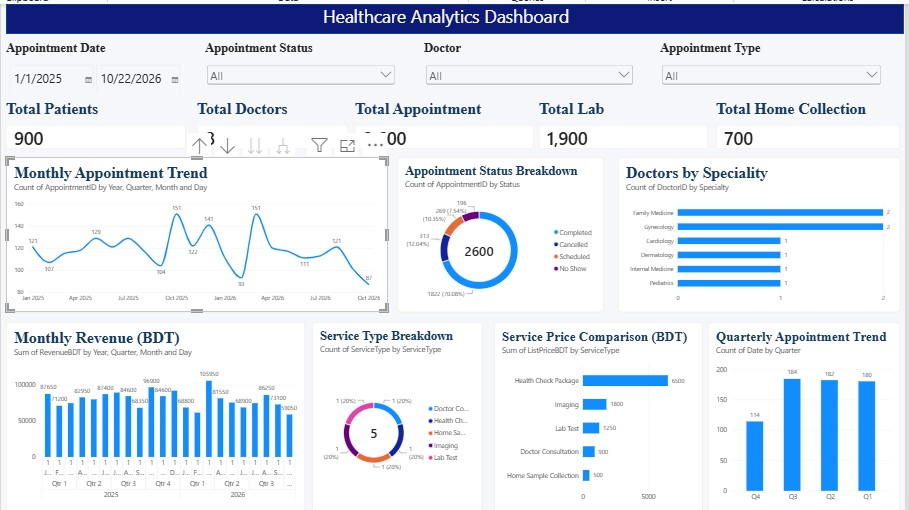

# Healthcare Analytics Dashboard

## Project Overview

This project focuses on analyzing healthcare data using Microsoft Power BI to generate meaningful insights into patient demographics, doctor performance, appointments, laboratory services, home collection services, and healthcare revenue.

The dashboard provides an interactive view of healthcare operations and helps identify trends, monitor performance, and support data-driven decision-making.

## Key Features

- Total Patients Analysis
- Doctor Performance Analysis
- Appointment Trends and Status Analysis
- Monthly Healthcare Revenue Analysis
- Laboratory Orders Analysis
- Home Collection Service Analysis
- Service Type Analysis
- Patient Demographics Analysis
- Interactive Filters and Drillthrough

## Tools & Technologies

- **Microsoft Power BI** – Data Visualization and Dashboard Development
- **DAX** – Measures and Calculations
- **Power Query** – Data Cleaning and Transformation
- **Microsoft Excel** – Data Preparation (if used)

## Project Objectives

- Analyze overall healthcare service performance.
- Understand patient demographics and activity.
- Monitor appointment trends and status.
- Evaluate doctor performance.
- Analyze laboratory orders and home collection services.
- Track monthly revenue and service performance.
- Support data-driven healthcare management decisions.

## Dashboard Preview

### Healthcare Overview

## Project Files

- `Healthcare_Analytics.pbix` – Power BI Dashboard

## Key Insights

- Healthcare service and patient activity trends.
- Appointment patterns and status distribution.
- Doctor and service performance.
- Monthly revenue trends.
- Laboratory and home collection service analysis.

## Author

**Alif Ahmed**

Data Analyst | Power BI | SQL | Data Visualization
